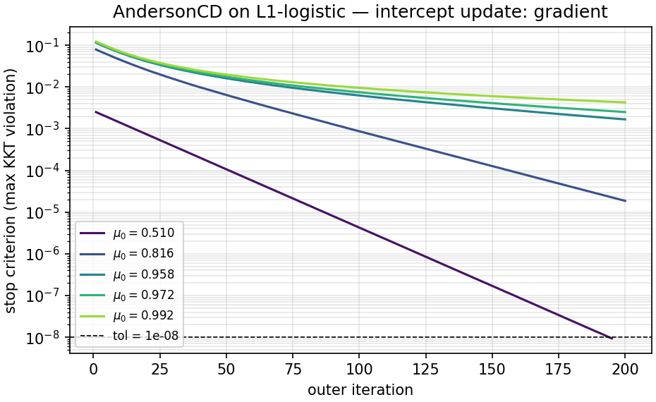
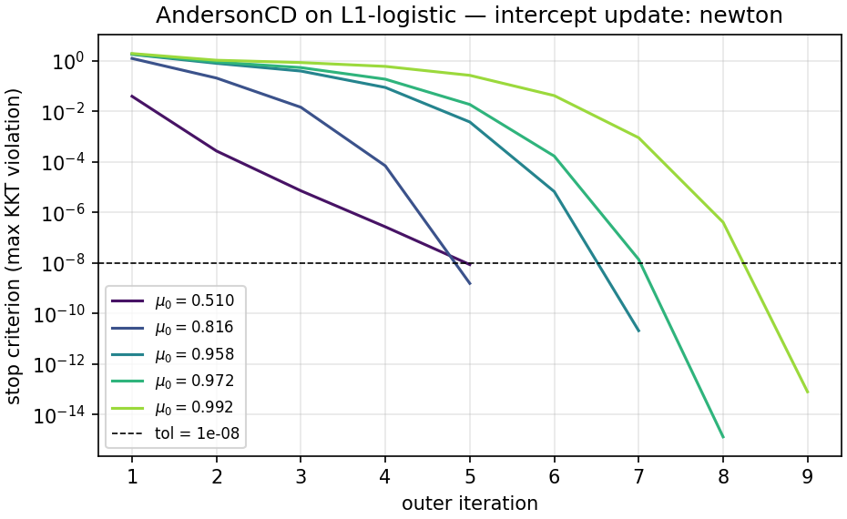

When you fit a regression model, the intercept is probably not the coefficient
you spend the most time thinking about. It represents the baseline response, is
usually left unpenalized, and rarely gets much attention in discussions of
optimization algorithms. But the way you update this one coefficient can have a
substantial effect on how quickly the solver fits the model.

Frederik Fabricius-Bjerre and I study this choice for regularized generalized
linear models in our new paper, *How to Train Your Intercept: A Comparison of
Intercept Update Strategies in Coordinate Descent*\ [@larsson2026d]. The [code
and manuscript source](https://github.com/jolars/intercepts) are available on
GitHub. Our main finding is that, when the response is imbalanced, a
conservative (but common) intercept update can slow down the whole solver. A
single Newton step, with a safeguard against overshooting, largely removes this
slowdown in our experiments.

To make this concrete, consider @fig-convergence. We fit the same regularized
logistic regression model to the **w1a** dataset\ [@platt1998] with three
strategies for updating the intercept. Everything else in our solver stays the
same. The Newton and exact strategies reach the target accuracy after roughly 45
sweeps through all the coefficients. The gradient strategy needs more than
*seven* times as many sweeps.

{#fig-convergence width="600px" fig-alt="Relative suboptimality bound versus elapsed time on w1a. Newton and exact intercept updates converge much sooner than the conservative gradient update."}

So, how we update the intercept *can* make a large difference, but the
literature does not examine this choice. My interest in this topic grew when I
noticed that implementations of optimization algorithms often differ in how they
update the intercept, even though they largely agree on the right way to update
every other coefficient. The papers describing these implementations neither
explain nor justify their choices.

This led me to propose the problem for a project course in statistics at my
department. Frederik was one of the students who chose to work on it. After the
course, we continued working together and have now wrapped up the work and
submitted the paper to a journal.

## The intercept in logistic regression

A logistic regression model describes the probability of a positive response as
$$
  p_i = \Pr(Y_i = 1 \mid x_i) = \frac{1}{1 + \exp[-(\beta_0 + x_i^\top\beta)]},
$$
where $\beta_0$ is the intercept and $\beta$ contains the feature coefficients.
If all the feature coefficients are zero, the intercept alone determines the
predicted probability. For example, a probability of $0.01$ corresponds to an
intercept of approximately $-4.6$.

We fit the model by minimizing the logistic loss plus a penalty on $\beta$, such
as the lasso penalty\ [@tibshirani1996]. The intercept is not penalized. A
common way to solve this problem is *coordinate descent*, which repeatedly
updates one coefficient at a time while holding the others fixed.^[My earlier
work on coordinate descent for SLOPE\ [@larsson2023] led me to look into this
issue. If you are unfamiliar with coordinate descent, @wright2015 provides an
accessible overview.] We call one sweep over the coefficients a *pass*. In
coordinate descent, the intercept is one of the coordinates, but it has special
properties: its update is smooth because it has no penalty, and it remains part
of every pass.

## Three ways to update the intercept

We compare three strategies, each applied once per pass over the feature
coefficients:

The gradient strategy
:   Take one step using a global, worst-case bound on the curvature of the loss.

The Newton strategy

:   Take one step using the curvature at the current fit.

The exact strategy
:   Minimize the loss over the intercept while holding the feature coefficients
    fixed.^[In the experiments, we solve this subproblem numerically to a tight
    tolerance.]

@fig-trajectories illustrates these choices for a small logistic regression
problem with one feature. The curves follow the intercept and feature
coefficient as the solver approaches the solution. The gradient strategy takes
many small steps, whereas the Newton and exact strategies arrive in only a few.

{#fig-trajectories width="600px" fig-alt="Objective contours with three optimization paths. The gradient path approaches the solution gradually, while the Newton and exact paths reach it in a few steps."}

## Why imbalance matters

For logistic regression, the curvature of the averaged loss in the intercept
direction is
$$
  H_{00} = \frac{1}{n}\sum_{i=1}^n p_i(1 - p_i).
$$
Since $p_i(1 - p_i)$ is at most $1/4$, we can use $L_0 = 1/4$ as a global
curvature bound. If $g_0$ denotes the derivative of the loss with respect to the
intercept, the gradient and full Newton updates are, respectively,
$$
  \beta_0 \leftarrow \beta_0 - \frac{g_0}{L_0},
  \qquad
  \beta_0 \leftarrow \beta_0 - \frac{g_0}{H_{00}}.
$$

The gradient step is a reasonable choice when the current curvature is close to
its upper bound. But when fitted probabilities approach zero or one,
$p_i(1 - p_i)$ becomes small, and the two step sizes can differ greatly. In an
intercept-only model with a fitted probability of $0.01$, the curvature is
$0.0099$. The full Newton step is then about 25 times as large as the gradient
step.^[This compares step sizes at the same iterate and does not imply a 25-fold
improvement in performance.]

Changing the feature coefficients can also change the best intercept value. If
the intercept update is too small to keep up, the solver uses that lagging
intercept when calculating the next feature updates. The intercept error changes
the gradients used for those updates, so a conservative intercept step can slow
progress across the whole model.

## Doesn't centering solve this?

If you are familiar with linear regression, you might wonder why we cannot just
center the features and separate the intercept from the slopes. For squared
loss, that works. The cross-curvature measures how changing the intercept
affects the gradient for a feature coefficient. For coefficient $j$, it is
proportional to the mean of feature $j$. Centering makes that mean zero, so we
can optimize the intercept independently of the feature coefficients.

For logistic regression, the corresponding quantity is
$$
  H_{0j} = \frac{1}{n}\sum_{i=1}^n p_i(1 - p_i)x_{ij}.
$$
This is a weighted feature mean. Ordinary centering makes the unweighted mean
zero, but generally leaves this weighted mean nonzero. The weights also change
as we fit the model. Standardizing the features therefore does not necessarily
remove the interaction between the intercept and the slopes.

In me and Jonas Wallin's [earlier work on
normalization](../2025-01-21-normreg/index.qmd), we focused on how feature
scaling changes regularization\ [@larsson2025]. Centering was simpler: with an
unpenalized intercept, we could center the features without changing the fitted
model. That remains true for logistic regression, but the computational benefit
does not carry over---ordinary centering no longer separates the intercept from
the slopes.

## How much work should we spend on the intercept?

If a lagging intercept causes trouble, an obvious response is to optimize it
fully after every pass. But our experiments suggest that this is usually wasted
work. With one safeguarded Newton step per pass, the solver typically follows
nearly the same trajectory as with exact intercept minimization, while taking
fewer steps to update the intercept. The next sweep over the feature
coefficients changes the best intercept value again. Solving for the intercept
very accurately before that sweep can therefore waste effort on accuracy that
will soon be lost.

The safeguard matters too. Newton's method approximates the loss near the
current fit by a quadratic function and chooses a step using that approximation.
If the approximation is poor, the step can be too large and increase the actual
loss. We see this in a Poisson example when starting a fit from scratch. A
backtracking line search checks each proposed step and shortens it until the
loss decreases enough.

## What happens in existing solvers?

We also study six production solvers. Some apply coordinate descent directly to
the original GLM loss. Others first approximate the loss by a quadratic
function, then use coordinate descent to solve that simpler problem.

Within a fixed quadratic approximation, the intercept's curvature is known, so
we can minimize over the intercept directly. But the choice of approximation
still matters. An approximation based on the curvature at the current fit adapts
to the problem. One based on a worst-case curvature bound can produce the same
overly small intercept steps as the gradient strategy.

### skglm

One instructive example comes from
[skglm](https://contrib.scikit-learn.org/skglm/). Version 0.5 used a
gradient-based update for the intercept. We [submitted a
patch](https://github.com/scikit-learn-contrib/skglm/pull/337) replacing that
update with a Newton step. @fig-skglm shows the convergence plots from the PR,
where $\mu_0$ is the fraction of positive responses. With the gradient update,
the most imbalanced problems remain far above the stopping tolerance after 200
outer iterations. With Newton updates, all five problems reach tolerance within
nine iterations.

::: {#fig-skglm layout-ncol=1}
{#fig-skglm-gradient width="700px" fig-alt="Before the patch: stopping criterion versus outer iteration for five response proportions. The nearly balanced problem reaches tolerance after about 200 iterations, while the more imbalanced problems remain above it."}

{#fig-skglm-newton width="700px" fig-alt="After the patch: stopping criterion versus outer iteration for the same five response proportions. All five problems reach their stopping tolerance within nine iterations."}

Convergence before (top) and after (bottom) replacing skglm's gradient-based
intercept update with a Newton step. The dashed lines show the stopping
tolerance.
:::

### Solvers using iteratively reweighted least squares

Solvers such as glmnet\ [@friedman2010] use iteratively reweighted least squares
(IRLS) to build a local quadratic approximation of the loss. Within each fixed
approximation, fitting the intercept is a weighted least squares problem with
constant curvature. A single Newton step therefore finds the best intercept
value. Using that constant curvature as the gradient strategy's bound gives the
same step, so all three strategies give the same update for this quadratic
problem.

These IRLS solvers avoid the slow convergence that we observe in our
experiments. I have become more and more convinced that IRLS is the better
approach for generalized linear models and have found that it often avoids some
convergence traps that direct coordinate descent can fall into.

## Conclusion

Our results usually favor one safeguarded Newton intercept update per pass. This
simple update avoids the convergence trap of the gradient strategy. Exact
intercept minimization requires more work and a more complex implementation, but
offers no benefit except in a few edge cases.

Our theoretical explanation is local, and we do not prove a general global
convergence rate for coordinate descent with Newton intercept updates.
Nevertheless, our analysis and experiments point to the same practical lesson:
keeping the intercept in step with the feature coefficients can make a large
difference, and doing so often requires only one well-chosen update per pass.
